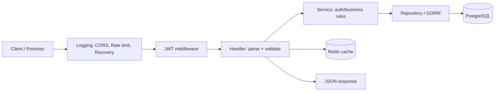
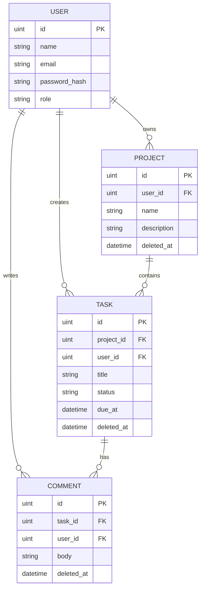

# BÁO CÁO ĐỒ ÁN: TASK MANAGEMENT API

**Họ tên:** Nguyễn Tuấn Anh

**Mã học viên:** 114010123020

**Lớp:** WD1113
**Tên bài tập:** Building Back-End with Golang  

## 1. Mục tiêu và phạm vi

Mục tiêu là xây dựng REST API quản lý công việc bằng Go, áp dụng phân lớp handler/service/repository, lưu dữ liệu trong PostgreSQL và giới hạn truy cập bằng JWT. Người dùng đăng ký, đăng nhập, tạo dự án, quản lý task và trao đổi qua comment. Mỗi người chỉ truy cập dữ liệu thuộc tài khoản của mình; quản lý user khác dành cho admin.

Phạm vi hiện thực gồm CRUD cho User, Project, Task và Comment; hash mật khẩu; validate request; response JSON thống nhất; pagination, filtering, sorting; Redis cache; CORS, logging, rate limiting; Docker và CI. Ứng dụng hỗ trợ graceful shutdown và soft delete bằng `gorm.DeletedAt`. Không bao gồm giao diện web, email, websocket hay nhóm quyền phức tạp.

## 2. Mô tả hệ thống và công nghệ

API dùng Gin để định tuyến. GORM ánh xạ model sang PostgreSQL và tự migrate schema lúc khởi động. Redis lưu response GET trong 30 giây; cache gắn với user ID để không lộ dữ liệu chéo tài khoản. Khi có thao tác ghi, cache của user được xóa. Nếu Redis không sẵn sàng, API tiếp tục hoạt động không cache.

Mật khẩu được băm bằng bcrypt. JWT HS256 có thời hạn 24 giờ. Secret đọc từ biến môi trường, không lưu trong repository. Gin binding dùng validator tích hợp để kiểm tra trường bắt buộc, email, độ dài và trạng thái task. Route private yêu cầu Bearer token.

| Thành phần | Công nghệ |
|---|---|
| Ngôn ngữ | Go |
| HTTP framework | Gin |
| Database | PostgreSQL, GORM |
| Cache | Redis |
| Xác thực | JWT HS256, bcrypt |
| Đóng gói | Docker multi-stage, Docker Compose |
| Tài liệu API | OpenAPI 3 (`docs/openapi.yaml`) |
| CI | GitHub Actions, go vet, go test, build, golangci-lint |

## 3. Kiến trúc ứng dụng

Mã nguồn chia thành `cmd/api` để khởi động server; `internal/handlers` parse/validate HTTP; `internal/services` xử lý đăng ký/xác thực; `internal/repositories` làm biên truy cập database; `internal/models` khai báo dữ liệu; `internal/middlewares` cung cấp JWT, cache, rate limit, recovery. Thư mục `docs/` chứa OpenAPI và báo cáo.

Request đi qua router Gin, middleware chung, rồi JWT cho route private. Handler kiểm tra body, path và phạm vi dữ liệu; service xử lý bcrypt và thông tin đăng nhập; GORM truy vấn PostgreSQL. Response JSON dùng status code phù hợp.

## 4. Thiết kế database

`users.email` duy nhất. Các khóa ngoại user/project/task được index. Model hỗ trợ soft delete; thao tác xóa thông thường đánh dấu `deleted_at`, truy vấn GORM mặc định bỏ qua bản ghi đã xóa.

## 5. Endpoint và response

| Method | Path | Mô tả | Status thành công |
|---|---|---|---|
| POST | `/api/v1/auth/register` | Đăng ký | 201 |
| POST | `/api/v1/auth/login` | Đăng nhập, cấp JWT | 200 |
| GET/POST | `/api/v1/users` | Danh sách/tạo user (admin) | 200/201 |
| GET/PUT/DELETE | `/api/v1/users/:id` | Đọc/cập nhật/xóa user | 200/200/204 |
| GET/POST | `/api/v1/projects` | Danh sách/tạo project | 200/201 |
| GET/PUT/DELETE | `/api/v1/projects/:id` | Đọc/cập nhật/xóa project | 200/200/204 |
| GET/POST | `/api/v1/tasks` | Danh sách/tạo task | 200/201 |
| GET/PUT/DELETE | `/api/v1/tasks/:id` | Đọc/cập nhật/xóa task | 200/200/204 |
| GET/POST | `/api/v1/comments` | Danh sách/tạo comment | 200/201 |
| GET/PUT/DELETE | `/api/v1/comments/:id` | Đọc/cập nhật/xóa comment | 200/200/204 |
| GET | `/health` | Health check | 200 |

Mọi endpoint trừ register, login, health yêu cầu `Authorization: Bearer <token>`. Body gửi dạng JSON. Response thành công đơn lẻ `{ "data": ... }`; list có thêm `meta` gồm page, limit và total. Lỗi `{ "error": {"code": "...", "message": "..."} }`. Schema chi tiết ở `docs/openapi.yaml`.

GET list hỗ trợ `page`, `limit` (tối đa 100), `sort`, `order`. Search/filter gồm `q` cho user/project, `status` và `project_id` cho task, `task_id` cho comment. Trường sort được whitelist để tránh dùng query input trực tiếp làm SQL.

## 6. Authentication và middleware

Khi đăng ký, API chuẩn hóa email, kiểm tra input và băm password bằng bcrypt trước khi lưu. Đăng nhập so sánh hash, sau đó ký JWT HS256 chứa subject và thời gian hết hạn. Middleware xác minh chữ ký, expiration và subject. Các query CRUD lọc theo `user_id`; biết ID bản ghi của user khác không đủ để truy cập.

Gin access logger ghi method, path, status và thời gian. Recovery trả lỗi JSON khi handler panic. CORS cho phép cross-origin; có thể thu hẹp origins trước production. Rate limiter mặc định 120 request/phút/IP/process. Redis cache dùng key có user ID và URI; mutation xóa cache của user hiện tại.

## 7. Kiểm thử

Unit test trong `internal/services/service_test.go` xác nhận password được lưu dạng bcrypt, email trùng bị từ chối và login chỉ thành công với mật khẩu đúng. Middleware test kiểm tra token thiếu/sai và giới hạn request. Chạy `go test ./...`, `go vet ./...`, `go build ./...` trước khi nộp.

**Kết quả chạy trên máy nộp:**  
Go version: ....................  
`go test ./...`: ................  
`go vet ./...`: .................  
`go build ./...`: ................  
Coverage (`go test -cover ./...`): ................

GitHub Actions tự chạy format check, vet, unit test, build và golangci-lint khi push/PR. Test hiện tập trung auth service và middleware; chưa có testcontainers cho PostgreSQL/Redis.

## 8. Docker, CI và triển khai

Dockerfile dùng multi-stage: stage Go biên dịch binary tĩnh, runtime distroless chỉ chứa binary. Compose chạy PostgreSQL, Redis và API, có health check. Kết nối database và JWT secret được truyền qua environment; `.env` nằm trong `.gitignore`.

Blueprint `render.yaml` mô tả web service Docker, PostgreSQL và Render Key Value. Để deploy, đẩy repository lên GitHub, tạo Blueprint trong Render và chọn repository. Sau khi service chạy, đăng ký tài khoản, cấp role admin qua database như hướng dẫn README, rồi kiểm tra `/health`, login và CRUD. Free Postgres Render hết hạn sau 30 ngày; free Key Value không giữ cache qua restart. Chọn plan phù hợp nếu cần dữ liệu bền.

**Link GitHub:** ........................................................  
**URL API đã deploy:** ..................................................  
**Video demo:** .........................................................

## 9. Khó khăn và bài học

Phân quyền cần áp dụng ngay trong điều kiện truy vấn database; chỉ xác minh JWT mà không lọc `user_id` có thể làm lộ dữ liệu. Vì vậy CRUD project/task/comment luôn giới hạn theo chủ sở hữu và kiểm tra quan hệ cha-con trước khi tạo task/comment. Cập nhật chỉ nhận trường cho phép, không nhận `user_id` hay `role` từ client.

Redis được thiết kế là thành phần phụ: khi cache lỗi, API vẫn đọc PostgreSQL. Cache key tách theo user và mutation invalidates các key tương ứng. CI phát hiện lỗi format, static analysis, unit test và build sớm. Bài tập giúp luyện chia tầng backend, response nhất quán, quản lý secret và đóng gói API cùng database bằng Docker.

## 10. Tổng kết

Sản phẩm cung cấp API quản lý task có xác thực, CRUD, phân quyền theo chủ sở hữu, database migration, cache, middleware, container và CI. Trước khi nộp, chạy các lệnh kiểm tra, triển khai Blueprint bằng tài khoản cá nhân, ghi URL thật, quay video demo 2–3 phút và điền thông tin trang bìa.
